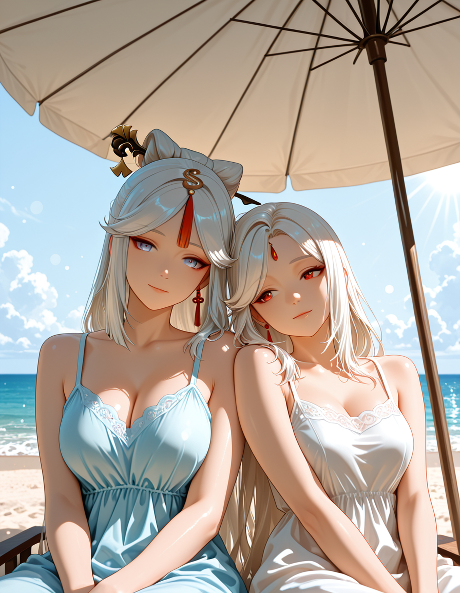
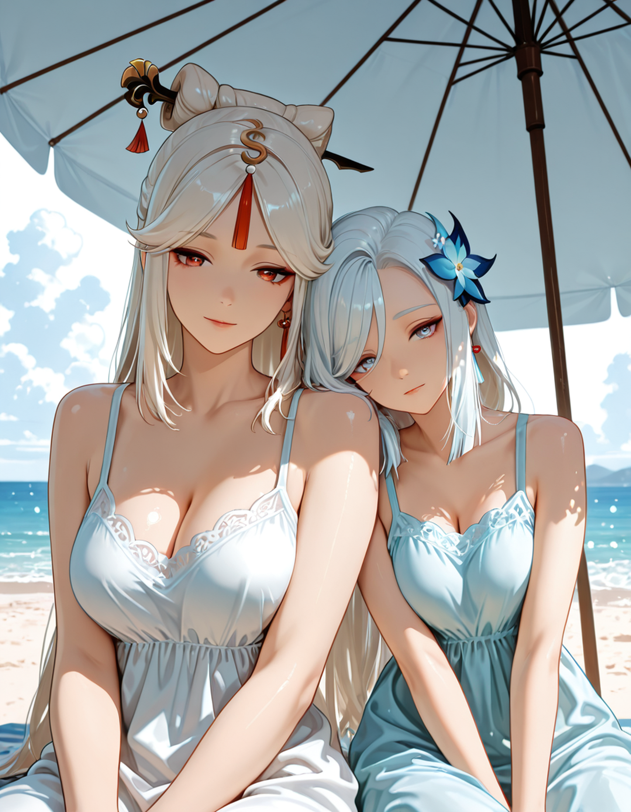
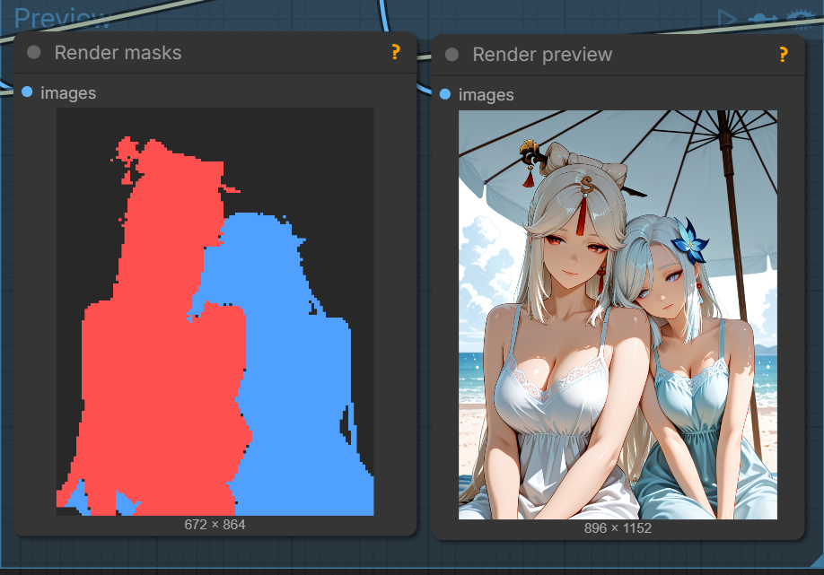
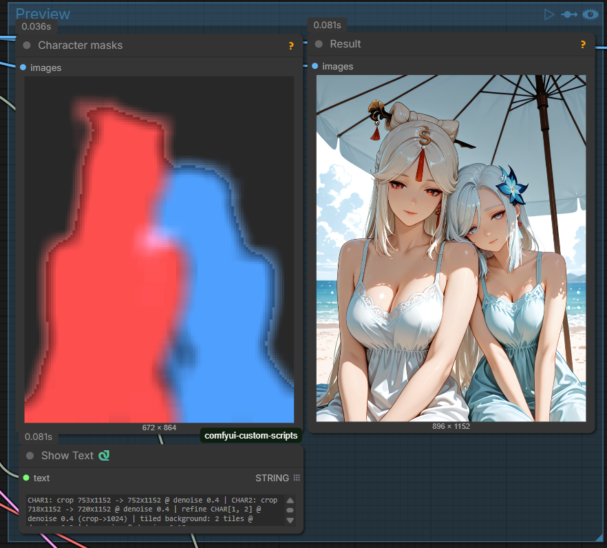

# ComfyUI-Unblend

[](LICENSE)
[](https://registry.comfy.org/publishers/latentdesireai/nodes/comfyui-unblend)

**Auto-separation of multiple anime characters in one image — no hand-drawn
masks, no regional-prompting spaghetti.** Built for SDXL / Illustrious and
compatible finetunes.

## The problem

You write a prompt for two characters and hit generate. Then it happens: their
hair colors mix, the eyepatch jumps to the wrong face, one character's signature
accessory ends up on the other — and at worst you get "twins," two people with
the same face. The closer they are (hugging, kissing, leaning on each other),
the worse it gets.

The usual fix is regional prompting with a pile of hand-drawn masks. It works,
but it's slow, fiddly, and falls apart on busy scenes. **Unblend removes that
manual grind: you just write the prompt.** The nodes find each character, build
clean per-character masks automatically, turn them into mutually-exclusive
regions, and feed those to regional attention. No hand-drawing.

## Before / after

A hard case on purpose: **Ningguang × Shenhe** (Genshin Impact) — two
white-haired characters, so a plain sampler blends their faces and swaps their
accessories. That makes the difference easy to see.

| Standard generation (no masks) | With Unblend |
|---|---|
|  |  |

**Left** — a normal prompt on a plain sampler: hair mixes, the forehead jewel
and hair ornament swap faces. **Right** — the same prompt through Unblend: you
write the text, the nodes do the masking, and each character stays herself.

## Install

**ComfyUI Manager (recommended).** Open the Manager, search **"Unblend"**, click
Install, and restart ComfyUI. The Python dependencies install automatically.

**Manual (git):**

```bash
cd ComfyUI/custom_nodes
git clone https://github.com/LatentDesireAI/ComfyUI-Unblend
pip install -r ComfyUI-Unblend/requirements.txt
```

Then restart ComfyUI. Install into the same Python environment ComfyUI runs in
(Windows portable build: `python_embeded\python.exe -m pip install -r
ComfyUI-Unblend\requirements.txt`).

You also need a **SAM segmentation node** for the hi-res instance masks — it is
**not** part of ComfyUI core. Install one separately (see
[Requirements](#requirements)).

## Quick start

Unblend uses **tagged prompts** so it knows what to lock to whom. A minimal
prompt looks like this:

```
[QUALITY] masterpiece, best quality, ultra detailed, absurdres
[STYLE] detailed hair, intricate details, very aesthetic
[SCENE] beach under a large parasol, white sand, bright sea behind, summer
[CHAR1] ningguang \(genshin impact\), hair stick, forehead jewel, long white hair, red eyes, (white sundress:1.15), sitting
[CHAR2] shenhe \(genshin impact\), hair ornament, long white hair, light blue eyes, (pale blue sundress:1.15), sitting
[INTERACT] sitting close under the parasol, shenhe resting head on ningguang's shoulder, arms linked
```

```
char_points = 0.3,0.45; 0.7,0.45
```

`char_points` are normalized `0..1` anchors on each character's head, in
`[CHARn]` order. Same `y`, different `x` = side by side; same `x`, different `y`
= stacked / lying.

Three rules that save the most pain (all learned from real bugs):

1. **Put the other character's name only in `[INTERACT]`**, never inside
   `[CHARn]` — otherwise it binds to the wrong mask and you get identity mixups.
2. **Keep each `[CHARn]` compact (~35–45 tokens) and the same length for both** —
   a long one breaks across the 77-token CLIP boundary, the character gets no
   mask, and you get a square instead of a silhouette.
3. **Maximize contrast** between characters (hair / eyes / clothes) — that's what
   the model tells them apart by.

Scales to 4 characters in theory (`[CHAR1]` … `[CHAR4]`); 2 is the sweet spot in
practice.

> 📝 Full cheat sheet — token order, `char_points` recipes, and troubleshooting
> (twins, style drift, traits leaking, disappearing signatures) — is in
> **[PROMPTING.md](PROMPTING.md)** (Russian: [PROMPTING_RU.md](PROMPTING_RU.md)).

## How it works (in plain terms)

Unblend runs as a **two-pass pipeline**.

**1. Composition pass — Unblend Dynamic Sampler.** Generates both characters in
a single pass. It rebuilds each character's mask from the model's own
cross-attention maps every few steps, then keeps her tokens locked inside her
own zone. No hand-drawn masks needed — the two come out already separated.



**2. Detail pass — Unblend Sequential Refine.** Instead of a second KSampler, it
redraws each character with **only her own `[CHARn]`** (zero neighbour tokens →
no feature leak), then details the background separately. The result: crisp
faces, clean accessories, no characters duplicated onto in-scene decor.



Between the two passes, an external **SAM** node produces clean instance masks
and **Assign Masks** labels them back to the right character using the same
`char_points`. Everything stays consistent.

## Nodes

| Node | What it does |
|---|---|
| **Unblend Dynamic Sampler (Bounded Attention)** | Main sampler: one pass, character masks are rebuilt from the model's own cross-attention maps every N steps + bias. `char_points` — normalized anchors (position + head identity, deterministic). `identity_lock` — boosts a character's own tokens inside its zone. `early_jail` — self-attn jail on the soft phase for side-by-side points. Solo fallback for 0–1 `[CHARn]`. Outputs a patched couple+jail model + draw conds for the detail pass. |
| **Unblend Assign Masks (SAM → CHARn by points)** | Bridge: labels unnamed instance masks (SAM, etc.) by `char_points` (the mask containing a point becomes that character). Handles occlusion. Solo mode (1 point → 1 character; no points → largest mask). Outputs ordered `char_masks` for Sequential Refine. |
| **Unblend Sequential Refine (per-char img2img)** | Detail pass in place of a second KSampler: per-character masked img2img with ONLY that `[CHARn]` (no neighbour tokens → zero feature leak), then a background pass (scene-only prompt — also suppresses character duplication onto in-scene paintings) and an optional seam harmonize. Pose is held by `noise_mask`. Run it AFTER the joint composition pass. **`per_char_upscale`** crops each character by its mask, upscales the crop and details it *there* — sharp faces even for a small hero on wide / horizontal art. **`bg_tiled`** splits the background into native-resolution tiles for canvas-wide detail (characters stay mask-locked, so no duplication on decor). |
| **Unblend Scene Book (JSON prompts)** | JSON "scene book": a shared `prefix` ([QUALITY]/[STYLE]) + a list of prompts, each with its own `char_points` and recommended orientation `horizontal` (true = landscape / false = portrait). By index, outputs `prefix` / `prompt` / `full_prompt` / `char_points` / `name` / `horizontal` separately. `wrap` pairs with the Line Counter for batch runs. Example: `example_workflows/scenes_demo.json`. |
| **Unblend Line Counter** | Prompt-file line number with auto-advance: repeat / increment / random / fixed. For a "file → stream of arts" pipeline. |
| **Unblend Pose Engine** | Pose extraction with engine choice: `rtmlib_humanart` (RTMPose + HumanArt — sees anime proportions, recommended) or `dwpose`. Returns an OpenPose image for ControlNet + a JSON of bodies. Can take boxes from a detector ("one skeleton per character"). |

## Pipeline

```
Scene Book (JSON) ─┬─► full_prompt ──► Dynamic Sampler ──► decode ──► SAM (external) ──┐
                   ├─► char_points ───────────┘                                        │
                   └─► horizontal ──► latent size switch                  Assign Masks ◄┘ (char_points)
                                                                                │
                                                                          Sequential Refine ──► upscale ──► save
```

- **Dynamic Sampler** separates the bodies in the composition pass.
- A SAM node (external) gives clean instance masks; **Assign Masks** labels them
  by the same `char_points`.
- **Sequential Refine** redraws each character with only its `[CHARn]` and
  details the background separately — no feature leak, no duplicates on decor.
- **Scene Book** + **Line Counter** drive a whole prompt collection by index.

A ready example graph ships in `example_workflows/unblend_workflow_example.json`.
It is **minimal on purpose** — it only shows the nodes wired together. Bring your
own checkpoint, style and upscalers.

## Requirements

If you install via **ComfyUI Manager**, the Python packages below are handled for
you. For a manual install (or just for reference), Unblend needs:

- An **SDXL / Illustrious** checkpoint.
- **`dghs-imgutils` / `dghs-realutils`** — internal silhouette + head detection
  used by the Dynamic Sampler. (In `requirements.txt`.)
- A **SAM segmentation node** for the hi-res instance masks feeding Assign Masks.
  SAM is **not** part of ComfyUI core — install a pack via **ComfyUI Manager**
  (search "segment anything" / "SAM"); SAM2 (kijai) and SAM3 packs both work.
- **`rtmlib`** (and `onnxruntime`) for `rtmlib_humanart` in the Pose Engine.
  (In `requirements.txt`.)

## Community

- **Question, idea, or want to show a result?** → open a thread in
  [Discussions](https://github.com/LatentDesireAI/ComfyUI-Unblend/discussions).
- **Found a bug?** → open an
  [Issue](https://github.com/LatentDesireAI/ComfyUI-Unblend/issues).
- **Got a fix?** → PRs welcome.

## Why I built this

Hi! I got into AI art generation, and over time I kept hitting the same thing:
characters tend to bleed details into each other. It bugged me, so I went
digging into the what / how / why. Most fixes use regional prompting and a pile
of masks — all by hand, which eats a ton of time. (There were automatic options
too, but they were complex and fiddly, and didn't always hold up, especially on
busy scenes.)

When Anthropic released **Fable 5**, I caught a short window with it and spent a
couple of days sketching out the ideas I had and testing them. After that I
finished the work with **Opus 4.8**. I'd love to see Fable 5 come back — I still
have ideas for optimizing a few of the steps.

So here they are — a lazy person's shortcuts that might make your generations a
little easier. If they saved you time, I'd be glad for any little bit via
[Ko-fi](https://ko-fi.com/latentdesire) 😋 — I burned a lot of time and tokens
dialing in the result.

Best regards, Alex

## Support the art

Unblend is free and MIT-licensed. The best way to give back is through the art
it was built to make:

**🔗 [linktr.ee/latentdesire](https://linktr.ee/latentdesire)** — Patreon, Ko-fi
and public galleries (Pixiv).

> ⚠️ **18+ / NSFW.** The Patreon and galleries contain adult artwork and the
> pages are age-gated. Not safe for work — 18+ only. The node itself is
> general-purpose.

## Credits

Built by **LatentDesireAI**, in collaboration with **Fable 5** and **Claude
Opus 4.8** — from the attention-kernel research through to this release.

## Development

Offline unit tests (no ComfyUI needed):

```
python tests/test_dynamic.py
python tests/test_helpers.py
python tests/test_patches.py
python tests/test_scene.py
```
